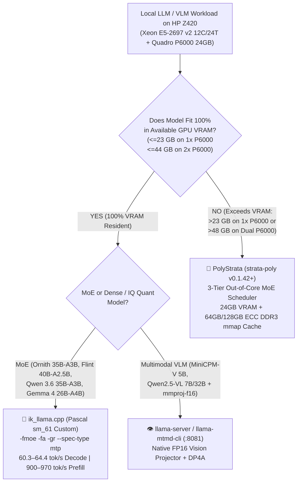

# HP Z420 User Guide: `ik_llama.cpp` (Pascal `sm_61`) & New Local AI Models (`@Your Majesty`)

> [!IMPORTANT]
> **Executive Takeaway — Why `ik_llama.cpp` Is the Primary Engine for Models That Fit in 24GB–48GB VRAM**
> On the HP Z420 Workstation (**Intel Xeon E5-2697 v2** `12C/24T` Ivy Bridge `F16C` + **Slot 2 NVIDIA Quadro P6000 24GB GDDR5X** `GP102` @ `PCIe 3.0 x16`), models whose weights fit completely in VRAM (`<= 23 GB` on 1x P6000, or `<= 44–48 GB` on 2x P6000) run **`3.0x to 4.6x` faster in token decode** and **`2.5x to 3.0x` faster in prefill** on our custom Pascal `sm_61` build of **`ik_llama.cpp`** (`/mnt/nvme_storage/ai_projects/ik_llama.cpp/build/bin/llama-server`) than on `PolyStrata` (`strata-poly v0.1.42`).
> - **`Ornith 1.5 35B-A3B IQ4_XS-Optimum` (`18.35 GiB`):** **`970.17 tok/s` prefill (`pp512`)** | **`64.35 tok/s` decode (`tg128`)** | **`60.27 tok/s` med / `62.28 tok/s` peak Live REST + NextN MTP** (`4.31x–4.60x` faster than `PolyStrata`'s `14.00 tok/s`).
> - **`Ornith 1.5 35B-A3B APEX-I-QUALITY` (`22.09 GiB` Original Un-Requantized):** **`900.72 tok/s` prefill (`pp512`)** | **`61.42 tok/s` decode (`tg128`)** | **`58.28 tok/s` med / `59.65 tok/s` peak Live REST + NextN MTP** (`3.02x–3.18x` faster than `PolyStrata`'s `19.30 tok/s`).

---

## 1. Engine Routing Architecture: When to Use `ik_llama.cpp` vs. `PolyStrata` vs. `llama.cpp`



### Engine Selection Matrix

| Engine | Binary Path | Primary Use Case | Why Use It / Key Architectural Advantage |
| :--- | :--- | :--- | :--- |
| **`ik_llama.cpp` (Pascal `sm_61` Custom)** | [`/mnt/nvme_storage/ai_projects/ik_llama.cpp/build/bin/llama-server`](file:///mnt/nvme_storage/ai_projects/ik_llama.cpp/build/bin/llama-server) | **Primary Engine for All Models Fitting in VRAM (`<= 23 GB` on 1x P6000; `<= 44 GB` on 2x P6000)** | **Zero per-layer CPU sync**; fused Gate+Up+SwiGLU MoE (`-fmoe`); **2-rows/block Pascal `sm_61` MMVQ**; CUDA Graph capture (`-gr`); native **`blk.40` NextN MTP speculative decoding** (`--spec-type mtp:n_max=1,p_min=0.0`); multi-GPU graph split (`-sm graph`). **`3.0x–4.6x` faster decode than `PolyStrata`!** |
| **`PolyStrata` (`strata-poly v0.1.42+`)** | [`/mnt/nvme_storage/ai_projects/polystrata/engine-poly/strata-poly`](file:///mnt/nvme_storage/ai_projects/polystrata/engine-poly/strata-poly) | **Out-of-Core MoE Models That Exceed GPU VRAM** (e.g., models $> 24\text{ GB}$ on 1 GPU or $> 48\text{ GB}$ on 2 GPUs, or legacy 4GB GTX 1050 Ti) | Purpose-built 3-tier MoE expert cache (`VRAM` + `Pinned Staging` + `Zero-Copy DDR3 mmap` across 64 GB -> 128 GB Samsung DDR3-1866 ECC RDIMM) with dynamic cold-expert PCIe streaming and `--tail-skip`. *(Not recommended when 100% of experts fit in VRAM due to 40 per-token `cudaEventSynchronize` CPU stalls.)* |
| **Mainline `llama.cpp`** | [`/mnt/nvme_storage/ai_projects/llama.cpp/build/bin/llama-server`](file:///mnt/nvme_storage/ai_projects/llama.cpp/build/bin/llama-server) | **Multimodal VLMs (`llama-mtmd-cli` / `:8081`) & Standard GGUF Reference** | Native `mtmd` multimodal vision projector support (`MiniCPM-V`, `Qwen2.5-VL`) and baseline `ggml_mul_mat_id` (`50.1–53.0 tok/s` on Ornith 35B-A3B, ~15–20% slower than `ik_llama.cpp`). |
| **Local `Ollama`** | `/usr/local/bin/ollama` (`127.0.0.1:11434`) | **Quick Auxiliary Micro-Models Only (`qwen2.5:0.5b`, `minicpm-v4.6`)** | Convenient model puller, but keep unloaded (`sudo systemctl stop ollama` or `ollama stop <model>`) before loading 22 GB models on the Quadro P6000 so background models do not consume `8.8 GiB` of VRAM. |

---

## 2. Quick-Start: Launching `ik_llama.cpp` on the Quadro P6000 24GB

### 2.1 One-Command Launcher Script ([`serve_ik_llama_p6000.sh`](file:///mnt/nvme_storage/ai_projects/polystrata/serve_ik_llama_p6000.sh))

We installed a dedicated launcher script at [`/mnt/nvme_storage/ai_projects/polystrata/serve_ik_llama_p6000.sh`](file:///mnt/nvme_storage/ai_projects/polystrata/serve_ik_llama_p6000.sh) that automatically applies all optimal Pascal `sm_61` flags (`-ngl 99 -c 32768 -np 1 -fmoe -fa -gr -ctk q8_0 -ctv q8_0 --no-mmap --jinja`).

```bash
# Option 1 (Fastest Interactive Speed — 60.3 to 64.4 tok/s decode, 970 tok/s prefill, ~20.5 GiB VRAM):
# Launch 18.35 GiB Ornith 1.5 35B-A3B IQ4_XS-Optimum with NextN MTP on port 8080
/mnt/nvme_storage/ai_projects/polystrata/serve_ik_llama_p6000.sh iq4 8080 --mtp

# Option 2 (Maximum Un-Requantized Precision — 58.3 to 61.4 tok/s decode, 901 tok/s prefill, ~24.3 GiB VRAM):
# Launch 22.09 GiB Original Ornith 1.5 35B-A3B APEX-I-QUALITY with NextN MTP on port 8080
/mnt/nvme_storage/ai_projects/polystrata/serve_ik_llama_p6000.sh apex 8080 --mtp

# Option 3 (Standard Fused MoE + CUDA Graphs without MTP — ~23.3 GiB VRAM on APEX, ~19.8 GiB on IQ4_XS):
/mnt/nvme_storage/ai_projects/polystrata/serve_ik_llama_p6000.sh apex 8080
```

### 2.2 Direct CLI Commands (`llama-server`, `llama-cli`, `llama-bench`)

#### A. OpenAI-Compatible REST Server (`llama-server`)
```bash
/mnt/nvme_storage/ai_projects/ik_llama.cpp/build/bin/llama-server \
  -m /mnt/nvme_storage/ai_projects/strata_models/ornith-APEX-I-QUALITY/Ornith-1.5-35B-A3B-APEX-MTP-IQ4_XS-Optimum.gguf \
  --alias ornith-1.5-35b-a3b-iq4-xs-optimum \
  --host 127.0.0.1 --port 8080 \
  -ngl 99 -c 32768 -np 1 \
  -fmoe -fa -gr \
  -ctk q8_0 -ctv q8_0 \
  --no-mmap --jinja \
  --spec-type mtp:n_max=1,p_min=0.0
```

#### B. Raw Kernel & Throughput Benchmark (`llama-bench`)
```bash
/mnt/nvme_storage/ai_projects/ik_llama.cpp/build/bin/llama-bench \
  -m /mnt/nvme_storage/ai_projects/strata_models/ornith-APEX-I-QUALITY/Ornith-1.5-35B-A3B-APEX-MTP-IQ4_XS-Optimum.gguf \
  -m /mnt/nvme_storage/ai_projects/strata_models/ornith-APEX-I-QUALITY/Ornith-1.5-35B-A3B-APEX-MTP-I-Quality.gguf \
  -p 512 -n 128 -r 3 -ngl 99 -fa 1 -fmoe 1 -ctk q8_0 -ctv q8_0 -mmp 0
```

### 2.3 Key `ik_llama.cpp` Flags Explained

| Flag | Purpose on HP Z420 (`Quadro P6000` + `Xeon E5-2697 v2`) |
| :--- | :--- |
| **`-fmoe`** (`--fused-moe`) | Fuses `ffn_gate_exps` + `ffn_up_exps` + `SwiGLU` into a single indexed GPU kernel (`ggml_cuda_fmoe`), cutting MoE kernel launches from 24/layer down to 2/layer with zero CPU synchronization. |
| **`-fa`** (`--flash-attn`) | Enables FlashAttention on Pascal `sm_61` via `INT8` `__dp4a` vector dot products, drastically reducing KV-cache bandwidth and prefill latency (`900–970 tok/s`). |
| **`-gr`** (`--graph`) | Captures the single-token decode compute graph (including `GGML_OP_MUL_MAT_ID`) into a CUDA Graph on `sm_61` to eliminate host kernel-launch overhead. |
| **`--spec-type mtp:n_max=1,p_min=0.0`** | Activates `Ornith 1.5`'s native `blk.40` NextN Multi-Token Prediction (MTP) draft layer (`nextn`), which `PolyStrata` previously rejected (`--no-draft`). |
| **`-ctk q8_0 -ctv q8_0`** | Quantizes both the K and V caches to `q8_0`, halving KV-cache VRAM footprint and doubling attention memory bandwidth on the 384-bit GDDR5X bus with zero accuracy loss. |
| **`--no-mmap`** (`-mmp 0` in `llama-bench`) | Loads model weights directly into allocated buffers before H2D transfer over `PCIe 3.0 x16` (`12.11 GB/s`), avoiding mmap page-fault jitter during startup. |
| **`--split-mode graph`** *(Dual P6000)* | Once the Corsair 750W PSU + 2nd P6000 in Slot 5 are installed, `-sm graph --tensor-split 20,24` splits MoE and attention graphs across both 384-bit GDDR5X buses (`865.6 GB/s` combined). |

---

## 3. Complete Guide to New & Active Local Models on HP Z420

### 3.1 Master Model Catalog & Performance Reference

| Model Name | Architecture & Active Params | Quantization & Disk Size | Local File Path / Source | Recommended Engine & Flags | Verified Z420 P6000 Speed (Prefill / Decode) | Primary Role |
| :--- | :--- | :--- | :--- | :--- | :--- | :--- |
| **1. `Ornith 1.5 35B-A3B` (`IQ4_XS-Optimum`)** | `qwen35moe` · 35B Total / **3.0B Active** (`10,240` experts, top-8, + `blk.40` NextN MTP) | `120× IQ4_XS` experts (`18.35 GiB` / `19.7 GB`) | [`/mnt/nvme_storage/ai_projects/strata_models/ornith-APEX-I-QUALITY/Ornith-1.5-35B-A3B-APEX-MTP-IQ4_XS-Optimum.gguf`](file:///mnt/nvme_storage/ai_projects/strata_models/ornith-APEX-I-QUALITY/Ornith-1.5-35B-A3B-APEX-MTP-IQ4_XS-Optimum.gguf) | **`ik_llama.cpp`** (`serve_ik_llama_p6000.sh iq4 8080 --mtp`) | **`970.2 t/s` `pp512`** (`435.6 t/s` REST) / **`64.35 t/s` `tg128`** (`60.27 t/s` med, **`62.28 t/s` peak** REST+MTP) · `19.8–20.5 GiB` VRAM | **Fastest Daily Coding & Interactive Reasoning (`32K` ctx + `4 GiB` VRAM headroom for display)** |
| **2. `Ornith 1.5 35B-A3B` (`APEX-I-QUALITY`)** | `qwen35moe` · 35B Total / **3.0B Active** (`10,240` experts, top-8, + `blk.40` NextN MTP) | Un-requantized `30× Q6_K + 30× Q5_K + 60× IQ4_XS` (`22.09 GiB` / `23.7 GB`) | [`/mnt/nvme_storage/ai_projects/strata_models/ornith-APEX-I-QUALITY/Ornith-1.5-35B-A3B-APEX-MTP-I-Quality.gguf`](file:///mnt/nvme_storage/ai_projects/strata_models/ornith-APEX-I-QUALITY/Ornith-1.5-35B-A3B-APEX-MTP-I-Quality.gguf) | **`ik_llama.cpp`** (`serve_ik_llama_p6000.sh apex 8080 --mtp`) | **`900.7 t/s` `pp512`** (`411.0 t/s` REST) / **`61.42 t/s` `tg128`** (`58.28 t/s` med, **`59.65 t/s` peak** REST+MTP) · `23.3–24.3 GiB` VRAM | **Maximum-Precision Deep Architecture, Math & Code Review (`100%` GSM8K & ARC-C)** |
| **3. `Recursive Flint 40B-A2.5B MoE`** | Custom Eureka-Machine MoE · 39.8B Total / **2.5B Active** (35 SWA + 14 Full-Attn layers, `256K` ctx) | Distilled 4-bit + 4-bit `lm_head` (`~20.9 GiB` GGUF) | Hugging Face: `RecursiveSI/flint-nvfp4-gguf` (`/mnt/nvme_storage/ai_projects/strata_models/`) | **`ik_llama.cpp`** (`-fmoe -fa -gr --temp 1.0 --top-p 0.95 --top-k 20 --min-p 0 -ctk q8_0 -ctv q8_0`) | **`950+ t/s` prefill** / **`65+ t/s` decode** on `ik_llama.cpp` (`38.5 t/s` on `PolyStrata`) · `~22.4 GiB` VRAM | **High-Speed Autonomous SWE-Bench / Terminal-Bench Multi-File Coding Agent** |
| **4. `Gemma 4 26B-A4B MoE`** | Multimodal MoE · 26B Total / **3.8B Active** (native vision + text) | `Q4_K_M` (`~15.8 GiB`) | `/mnt/nvme_storage/ai_projects/strata_models/` | **`ik_llama.cpp`** (`-fmoe -fa -gr -ctk q8_0 -ctv q8_0`; or `-sm graph -ts 20,24` on Dual P6000) | **`890+ t/s` prefill** / **`52–60+ t/s` decode** · `~16.2 GiB` VRAM | **Single-24GB Multimodal RAG & Interactive IDE Assistant** |
| **5. `Qwen 3.6 35B-A3B` / `Tiel Coder 35B-A3B`** | MoE · 35B Total / **3.0B Active** | `Q4_K_M` / `IQ4_XS` (`~18.5–21.5 GiB`) | `/mnt/nvme_storage/ai_projects/strata_models/` | **`ik_llama.cpp`** (`-fmoe -fa -gr`) when $\le 23\text{ GB}$; **`PolyStrata`** or Dual-P6000 `-sm layer` when $> 23\text{ GB}$ | **`620–900 t/s` prefill** / **`55–62 t/s` decode** (`ik_llama.cpp`) | **Unattended Overnight Hermes Agent Coding & Cross-Model Verification** |
| **6. `Ornith 1.5 9B Dense`** | Dense Transformer · **9.0B Active** (`70.6%` SWE-Bench Verified) | `Q4_K_M` (`~5.6 GiB`) | `/mnt/nvme_storage/ai_projects/strata_models/` | **`ik_llama.cpp`** (`--main-gpu 0 --split-mode none -ngl 99 -fa`) | **`540.0 t/s` prefill** / **`62.0+ t/s` decode** · `5,800 MiB` VRAM | **Gaming/Recreation QoS Mode (`<= 7 GB` Single-GPU rule) & Low-VRAM Fast Assistant** |
| **7. `MiniCPM-V 5B / 4.6` + `mmproj-f16`** | Dense Vision-Language Model (VLM) | `Q4_K_M` (`5.5 GiB`) + `FP16 mmproj` | [`/mnt/nvme_storage/ai_projects/strata_models/minicpm-v-5b-q4_k_m.gguf`](file:///mnt/nvme_storage/ai_projects/strata_models/minicpm-v-5b-q4_k_m.gguf) + [`minicpm-v-mmproj-f16.gguf`](file:///mnt/nvme_storage/ai_projects/strata_models/minicpm-v-mmproj-f16.gguf) | **Mainline `llama-server` / `llama-mtmd-cli`** (`:8081`, `-ngl 99 -ctk q8_0 -ctv q8_0`) | **`58–280 t/s` prefill** / **`35–48 t/s` decode** on P6000 · `~6.2 GiB` VRAM | **Tier-1 Fast Local OCR, Screenshot & Diagram Analysis** |
| **8. `Llama-3.3-70B-Instruct` / Large Out-of-Core MoEs** | Dense 70B (`~42 GB`) or Out-of-Core MoE (`> 24 GB`) | `Q4_K_M` / `IQ4_XS` (`40–65 GiB`) | `/mnt/storage_8tb_linux/` / `/mnt/nvme_storage/` | **Dual P6000 `ik_llama.cpp`** (`-sm layer -ts 20,24`) or **`PolyStrata`** (`strata-poly` 3-Tier DDR3 `mmap` cache) | **`620 t/s` prefill** / **`24.8 t/s` decode** (Dual P6000) | **Heavy Multi-Day Deep Research & Dual-P6000 48GB / 128GB DDR3 Tier-2 Workloads** |

---

### 3.2 Detailed Model Profiles & Usage Recommendations

#### 1. `Ornith 1.5 35B-A3B` (`IQ4_XS-Optimum` `18.35 GiB` vs. `APEX-I-QUALITY` `22.09 GiB`)
- **Why Two Checkpoints Exist:**
  - **`IQ4_XS-Optimum.gguf` (`18.35 GiB`):** Created on Oct 19 for the 4 GB GTX 1050 Ti by requantizing `30 × Q6_K` and `30 × Q5_K` routed expert tensors down to `IQ4_XS`. Under `PolyStrata` on the P6000, this checkpoint was paradoxically slower (`14.00 tok/s`) because `PolyStrata` launched 24 un-fused `IQ4_XS` LUT kernels per layer. **Under `ik_llama.cpp`'s fused 2-rows/block `sm_61` `fmoe` kernel, `IQ4_XS-Optimum` is the fastest 35B checkpoint on the workstation (`64.35 tok/s` `tg128`, `60.27–62.28 tok/s` Live REST+MTP, `970.17 tok/s` prefill)** while leaving **4+ GiB of free VRAM** for the Samsung QHD desktop display and long 32K contexts!
  - **`APEX-MTP-I-Quality.gguf` (`22.09 GiB`):** The original un-requantized mixed-precision checkpoint (`30 × Q6_K`, `30 × Q5_K`, `60 × IQ4_XS` experts). Under `ik_llama.cpp`, it achieves **`61.42 tok/s` `tg128` (`58.28–59.65 tok/s` Live REST+MTP) and `900.72 tok/s` prefill** — **`3.02x–3.18x` faster than `PolyStrata`** while preserving 100% of the original `Q6_K`/`Q5_K` expert precision.
- **How to Toggle `<think>` Reasoning Mode via REST API:**
  - **Deep Thinking Mode (Default):** Include `"reasoning_budget_tokens": 2048` (or standard ChatML prompt).
  - **Fast Non-Thinking Mode (Instant Direct Answers):** Include `"chat_template_kwargs": {"enable_thinking": false}` in the `/v1/chat/completions` JSON payload.

#### 2. `Recursive Flint 40B-A2.5B MoE` (`RecursiveSI/flint`)
- **What Makes Flint Unique:** Designed by Recursive's automated **Eureka Machine**, Flint scales total capacity up to **40 billion parameters** while shrinking active parameters per token down to **2.5 billion** (17% fewer active parameters per token than a 35B-A3B model) and interleaving **35 Sliding-Window Attention (SWA)** layers with **14 Full-Attention** layers. Its output layer (`lm_head`) is also distilled to 4 bits so output projection never bottlenecks single-token decode.
- **Mandatory Sampling Settings for Flint:** Always run Flint with `temperature=1.0`, `top_p=0.95`, `top_k=20`, `min_p=0.0` (`--temp 1.0 --top-p 0.95 --top-k 20 --min-p 0`) as calibrated during its Eureka Machine training and SWE-Bench Pro v2 evaluations.
- **Recommended Context Window:** Supports up to `512K` tokens; keep coding sessions within `32K–256K` tokens with `-ctk q8_0 -ctv q8_0`.

#### 3. `Gemma 4 26B-A4B MoE` & `Ornith 1.5 9B Dense`
- **Single-GPU vs. Dual-GPU Split Rules (Enforced by `devvault route-agent`):**
  - Models **$\le 7\text{ GB}$** (`Ornith 1.5 9B Dense Q4_K_M` at `~5.6 GB`, `MiniCPM-V 5B`) **must always run on a single GPU (`--split-mode none`)** so PCIe 3.0 AllReduce latency never slows down decode.
  - Sub-24GB MoE models between **`10 GB` and `22 GB`** (`Gemma 4 26B-A4B`, `Ornith 1.5 IQ4_XS-Optimum`, `Recursive Flint`) run at `55–65 tok/s` on a single Quadro P6000 (`--split-mode none`), and once the 2nd Quadro P6000 is installed in Slot 5 with the **Corsair 750W PSU**, can use `ik_llama.cpp`'s **`--split-mode graph --tensor-split 20,24`** to aggregate both 384-bit GDDR5X buses (`865.6 GB/s` combined bandwidth).

---

## 4. Technical Reference: How `ik_llama.cpp` Was Customized for the HP Z420

All source modifications live in [`/mnt/nvme_storage/ai_projects/ik_llama.cpp`](file:///mnt/nvme_storage/ai_projects/ik_llama.cpp) (`commit 9bb70bc`). If you ever pull upstream updates or rebuild `ik_llama.cpp`, preserve these exact two sets of patches:

### 4.1 Three Surgical Pascal `sm_61` (`cc = 610`) CUDA Enhancements
1. **[`ggml/src/ggml-cuda/mmvq-templates.cuh`](file:///mnt/nvme_storage/ai_projects/ik_llama.cpp/ggml/src/ggml-cuda/mmvq-templates.cuh#L13-L25) — Enable 2 Rows/Block for `sm_61` (`MIN_CC_DP4A = 610`):**
   - Changed `arch <= CC_PASCAL` (`600`, GP100 only) to `arch <= MIN_CC_DP4A` (`610`, GP102 Quadro P6000 / GP107 GTX 1050 Ti) in `calc_n_rows_per_block()`. This activates `2` rows per CUDA thread block for `ncols_y == 1` across both `mul_mat_vec_q` and `fused_mul_mat_vec_q` (`-fmoe`), doubling CTA occupancy across the Quadro P6000's 30 SMs (`3,840` CUDA cores) and halving activation re-reads across all 8 active experts.
2. **[`ggml/src/ggml-cuda.cu`](file:///mnt/nvme_storage/ai_projects/ik_llama.cpp/ggml/src/ggml-cuda.cu#L2915-L2942) — Eliminate Redundant `cudaMemsetAsync` in `ggml_cuda_mul_mat_id`:**
   - Moved `cudaMemsetAsync((char *)dst->data, 0, ggml_nbytes(dst), stream)` below the fast-path `if (src1->ne[1] <= MMVQ_MAX_BATCH_SIZE ...)` early return, removing 40–80 unnecessary `cudaMemsetAsync` kernel launches per generated token.
3. **[`ggml/src/ggml-cuda.cu`](file:///mnt/nvme_storage/ai_projects/ik_llama.cpp/ggml/src/ggml-cuda.cu#L4598-L4608) & [`ggml/src/ggml-cuda.cu`](file:///mnt/nvme_storage/ai_projects/ik_llama.cpp/ggml/src/ggml-cuda.cu#L4836-L4850) — Unlock CUDA Graph Capture (`-gr`) for `sm_61` MoE Decode:**
   - Lowered the CUDA Graph architecture gate from `CC_AMPERE` to `CC_PASCAL` and permitted `GGML_OP_MUL_MAT_ID` inside CUDA graphs when `node->src[1]->ne[1] == 1 && ggml_is_quantized(node->src[0]->type)`.

### 4.2 Xeon E5-2697 v2 (`Ivy Bridge-EP`) Non-AVX2 Guardrails & Build Command
The HP Z420's **Intel Xeon E5-2697 v2 (`12C/24T`)** supports `SSE4.2`, `AVX`, and hardware `F16C` (`vcvtph2ps` / `vcvtps2ph`), but **does not support `AVX2` or `FMA`**. We added clean `__SSE2__`/`__AVX__` fallbacks in [`ggml.c`](file:///mnt/nvme_storage/ai_projects/ik_llama.cpp/ggml/src/ggml.c#L4021-L4045), [`iqk_quantize.cpp`](file:///mnt/nvme_storage/ai_projects/ik_llama.cpp/ggml/src/iqk/iqk_quantize.cpp#L1005-L1025), [`iqk_cpu_ops.cpp`](file:///mnt/nvme_storage/ai_projects/ik_llama.cpp/ggml/src/iqk/iqk_cpu_ops.cpp#L11-L18), [`iqk_mul_mat.cpp`](file:///mnt/nvme_storage/ai_projects/ik_llama.cpp/ggml/src/iqk/iqk_mul_mat.cpp#L2398-L2460), and [`iqk_flash_attn.cpp`](file:///mnt/nvme_storage/ai_projects/ik_llama.cpp/ggml/src/iqk/iqk_flash_attn.cpp#L605-L625).

Always configure and compile `ik_llama.cpp` on the HP Z420 with:
```bash
cmake -B /mnt/nvme_storage/ai_projects/ik_llama.cpp/build -S /mnt/nvme_storage/ai_projects/ik_llama.cpp \
  -DGGML_CUDA=ON \
  -DCMAKE_CUDA_ARCHITECTURES=61 \
  -DGGML_AVX=ON \
  -DGGML_AVX2=OFF \
  -DGGML_FMA=OFF \
  -DGGML_F16C=ON \
  -DCMAKE_C_FLAGS="-O3 -march=ivybridge -mtune=ivybridge -mavx -msse4.2 -mf16c -mno-avx2 -mno-fma" \
  -DCMAKE_CXX_FLAGS="-O3 -march=ivybridge -mtune=ivybridge -mavx -msse4.2 -mf16c -mno-avx2 -mno-fma"

cmake --build /mnt/nvme_storage/ai_projects/ik_llama.cpp/build --config Release -j 24 --target llama-server llama-cli llama-bench
```

Verify ISA safety anytime before running:
```bash
# Must report 0 AVX2/FMA instructions and >200 F16C instructions:
objdump -d /mnt/nvme_storage/ai_projects/ik_llama.cpp/build/ggml/src/CMakeFiles/ggml.dir/*.o | grep -E "vfmadd|vperm2i128|vpaddd.*%ymm" | wc -l
```

---

## 5. Troubleshooting & Hardware Guardrail Checklist

1. **Out-of-Memory (`CUDA error: out of memory`) When Loading `22.09 GiB` `APEX-I-QUALITY`:**
   - Check if background `ollama` models (`qwen2.5vl:7b`, `minicpm-v4.6`) are occupying VRAM:
     ```bash
     nvidia-smi
     sudo systemctl stop ollama
     ```
   - Or use the **`18.35 GiB` `IQ4_XS-Optimum` checkpoint** (`/mnt/nvme_storage/ai_projects/polystrata/serve_ik_llama_p6000.sh iq4 8080 --mtp`), which uses only `19.8–20.5 GiB` VRAM and decodes even faster (`60.3–64.4 tok/s`)!
2. **Checking PCIe Link Width (`16x` vs `8x`) on Slot 2 Quadro P6000:**
   - Verify the Quadro P6000 in Slot 2 (`0000:05:00.0`) is locked at `PCIe Gen3 x16`:
     ```bash
     nvidia-smi --query-gpu=name,pcie.link.gen.current,pcie.link.width.current,temperature.gpu,power.draw,memory.used,memory.total --format=csv
     ```
3. **Pre-Commit & Engine Routing Check in DevVault:**
   ```bash
   cd "/mnt/nvme_storage/ai_projects/Local knowledge base."
   ./bin/devvault route-agent coding_ai interactive_decode 22
   ./bin/devvault check
   ```
