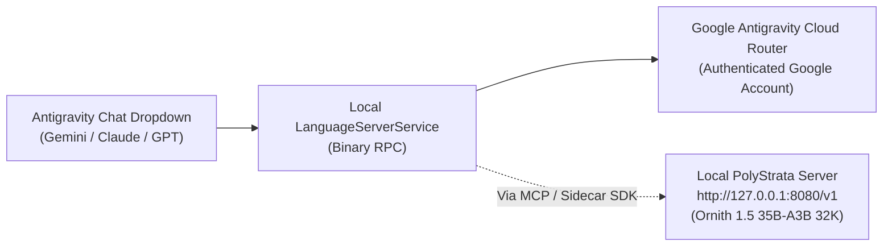

# Plan: Integrating Ornith 1.5 into the Antigravity IDE Chat GUI & Model Selector

## 1. Architectural Reality: How the Native Chat Box Model Dropdown Works

In **Antigravity IDE** (and Antigravity 2.0), the model selector dropdown inside the built-in primary chat box (which lists **Gemini 3.1 Pro**, **Gemini 3 Flash**, **Claude Sonnet/Opus**, and **GPT-OSS**) is **not** populated from a local config file.



> [!IMPORTANT]
> **Why Ornith 1.5 isn't in that specific dropdown:**
> The native Antigravity chat dropdown only lists cloud orchestrator models served by Google's backend (`LanguageServerService`), because the primary Antigravity agent loop relies on Google's proprietary server-side tool-calling protocol. Antigravity does not currently expose a `customModels` or `openaiCompatible` JSON setting that injects local `localhost:8080` endpoints into that specific cloud dropdown list.

However, you **can** get a full **Model Selector GUI + Chat Box** for `Ornith 1.5 35B-A3B` right inside the Antigravity IDE window using one (or a combination) of the **three supported architectures** below.

---

## 2. Three Ways to Get an Ornith 1.5 GUI & Model Selector in Antigravity IDE

### Option A: Native Antigravity UI Extension ("Ornith Studio" Side Pane) — *Recommended*
Antigravity has a built-in **UI Extension (`sidecar_sdk`)** system that embeds a theme-aware local web panel directly in the **right-hand Auxiliary Pane** beside your conversation (and surfaces a one-click pill inside the chat box to toggle it open).

* **Location:** `~/.gemini/config/plugins/ornith-studio/`
* **What You Get in the GUI:**
  1. **Model / Reasoning Mode Selector Dropdown:**
     * `Ornith 1.5 35B-A3B — Thinking (2K Budget)` *(Default, balanced accuracy)*
     * `Ornith 1.5 35B-A3B — Fast (No Thinking)` *(Instant code generation)*
     * `Ornith 1.5 35B-A3B — Deep Review (4K Budget)` *(Complex bug hunts)*
  2. **Live Z420 Hardware Telemetry Header:**
     * Real-time **GTX 1050 Ti VRAM meter** (`3469 / 4096 MiB`), **System RAM**, **Decode speed (`~20–24 tok/s`)**, and **Suffix-Drafter acceptance (`~71%`)**.
     * One-click **Start Engine** / **Unload VRAM** toggle button right in the header.
  3. **Streaming Chat & Collapsible `[Thinking]` Accordion:**
     * Streams tokens live from `http://127.0.0.1:8080/v1/chat/completions` with collapsible reasoning traces and copyable code blocks.
  4. **One-Click Bridge to the Main Antigravity Chat (`window.sidecar.agent`):**
     * **"Send to Main Agent"** button on any Ornith response so the main Gemini/Claude agent can immediately apply Ornith's code edits to your workspace.

---

### Option B: Add Ornith 1.5 to a VS Code Chat Extension's Model Dropdown (Continue / Cline / Roo Code)
Because **Antigravity IDE** is built on VS Code (`~/.config/Antigravity`), you can install **Continue**, **Cline**, or **Roo Code** from the Extensions sidebar. Unlike Antigravity's cloud-locked dropdown, these extensions have an open **Model Select GUI dropdown** in their chat box that natively accepts local OpenAI-compatible servers.

* **Config (`~/.continue/config.yaml` or Cline settings):**
  ```yaml
  models:
    - name: "Ornith 1.5 35B-A3B (Z420 32K - Thinking)"
      provider: openai
      model: Ornith-1.5-35B-A3B-APEX-MTP-I-Quality
      apiBase: http://127.0.0.1:8080/v1
      apiKey: local-polystrata
      contextLength: 32768
    - name: "Ornith 1.5 35B-A3B (Z420 32K - Fast No-Think)"
      provider: openai
      model: Ornith-1.5-35B-A3B-APEX-MTP-I-Quality
      apiBase: http://127.0.0.1:8080/v1
      apiKey: local-polystrata
      contextLength: 32768
      requestOptions:
        extraBodyProperties:
          enable_thinking: false
  ```
* **Result:** `Ornith 1.5 35B-A3B` shows up directly in the **Model Select dropdown** of that chat box alongside any cloud models you configure.

---

### Option C: Primary Chat Box `@ornith` Subagent & Plugin Bundle
In the native Antigravity chat box (where you select Gemini/Claude/GPT), we can package our [ornith_mcp_server.py](file:///mnt/nvme_storage/ai_projects/polystrata/serve/ornith_mcp_server.py) and [SKILL.md](file:///home/tom/.gemini/config/skills/ornith-local-llm/SKILL.md) into a full **Antigravity Plugin** (`~/.gemini/config/plugins/ornith-z420/`) with:
* A dedicated custom subagent (`agents/ornith.md`) and rule (`rules/AGENTS.md`).
* **How it works in the main chat box:** You leave the main dropdown on a fast/light model (like **Gemini 3 Flash**), and type `@ornith` (or `"use Ornith:"`) in the chat box. The main chat acts as a thin pass-through that delegates the prompt to local `Ornith 1.5 35B-A3B` via MCP and displays Ornith's verbatim output + telemetry in the main chat stream.

---

## 3. Proposed Implementation Steps (If Proceeding with Option A + Option C)

1. **Create the `ornith-studio` Antigravity Plugin (`~/.gemini/config/plugins/ornith-studio/`):**
   * `plugin.json` — Plugin manifest with `displayName: "Ornith 1.5 (Z420 Local LLM)"`, custom SVG logo (`assets/logo.svg`), and `suggestedPrompts`.
   * `sidecars/panel/sidecar.json` — Sidecar manifest registered at `SIDECAR_UI_ENTRYPOINT_AUX_PANE`.
   * `sidecars/panel/main.mjs` — Node.js `SidecarApp` backend that proxies requests to `http://127.0.0.1:8080` (`chat`, `status`, `start`, `unload`) so there are zero CORS issues.
   * `sidecars/panel/index.html`, `app.js`, `styles.css` — Theme-aware GUI featuring the **Model/Mode Selector dropdown**, live **VRAM & tok/s status bar**, **Start/Stop engine controls**, collapsible `[Thinking]` viewer, and **"Send to Agent"** button.
2. **Enable the Plugin Live via `LanguageServerService` RPC:**
   * Register and enable `ornith-studio` so it appears in the Antigravity **Customizations -> Installed** page and **Extensions (`⋮`)** menu.
3. **(Optional) Pre-write `~/.continue/config.json`:**
   * So if you ever open the Continue extension inside Antigravity IDE, `Ornith 1.5 35B-A3B (32K)` is already populated in its model selector dropdown.
